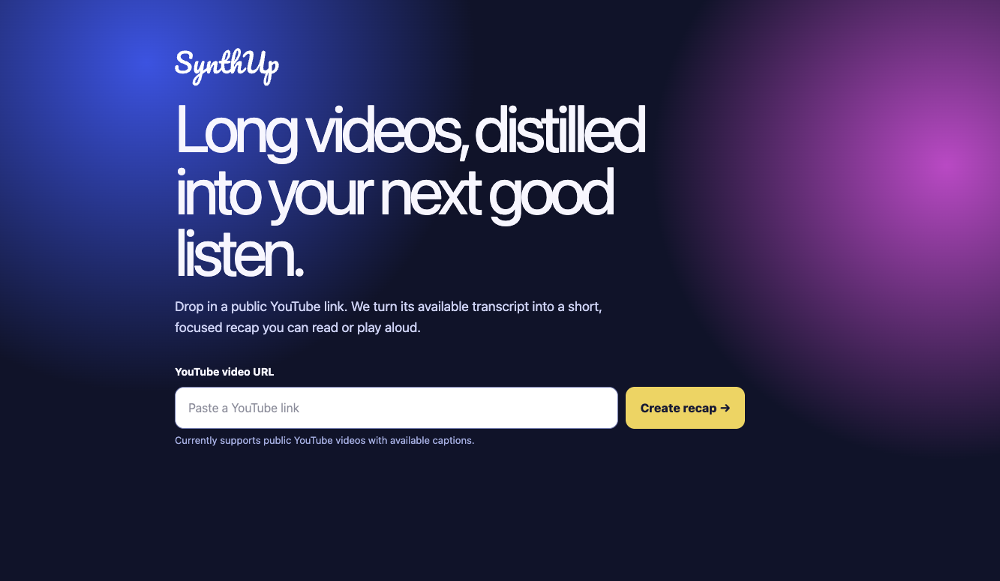

# SynthUp

SynthUp turns long-form YouTube videos into short recaps that are easier to read and listen to.

## Reference



## Current MVP

1. Paste a public YouTube URL with available captions.
2. Fetch its transcript and create a five-sentence extractive recap.
3. Read the recap or play it with the browser's built-in voice preview.

This is a deliberately narrow first release. Durable AI narration, saved libraries, accounts, and more source types are not implemented yet.

## Local development

### Client

```bash
cd client
cp .env.example .env
# Set VITE_APP_API_BASE_URL to http://localhost:8000
npm install
npm run dev
```

### API

```bash
cd server
python -m venv .venv
source .venv/bin/activate
pip install -r requirements.txt
cp .env.example .env
python3 -m nltk.downloader -d nltk_data punkt punkt_tab
python3 -m fastapi dev main.py
```

The client is served at `http://localhost:5173`; the API is served at `http://localhost:8000` and exposes a health check at `/ping`.

## Next production milestone

Replace the local extractive summarizer and browser voice preview with an asynchronous provider-backed pipeline: transcript retrieval, structured LLM recap, TTS generation, object storage, and job status tracking.
